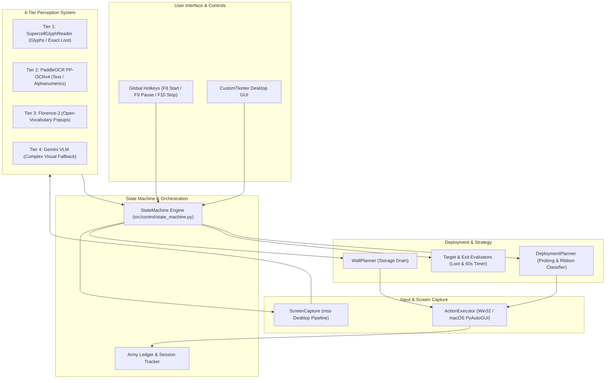

# 🛡️ Clash of Clans Autonomous Farming Controller

[](https://www.python.org/)
[](https://github.com/guyteche7-cmd/coc-farming-controller)
[](https://github.com/RapidAI/RapidOCR)
[](LICENSE)

An intelligent, computer-vision and AI-powered autonomous farming system for **Clash of Clans** on **Windows PC & macOS** (BlueStacks, LDPlayer 9, Google Play Games PC).

Designed from the ground up for cross-platform reliability, zero hallucinations, and safety, this controller automates matchmaking loot evaluation, intelligent single-spot troop probing, universal multi-troop army deployment, hero ability triggering, wall upgrades, and storage capacity limits.

---

## 🌟 Key Features

### 1. 👁️ 4-Tier Zero-Hallucination Perception Hierarchy
- **Tier 1: Deterministic Pixel Glyph Matching (`SupercellGlyphReader`)**:
  - Uses normalized cross-correlation against authentic Supercell-Magic font templates for all in-game numerical values (available loot, storages, combat countdown timers, destruction %).
  - Delivers **100% mathematical zero-hallucination precision** in under 5ms without neural network drift.
- **Tier 2: PaddleOCR PP-OCRv4 ONNX (`PaddleOCREngine`)**:
  - Accelerated text and alphanumeric perception for player tags, clan names, village labels, and confirmation modals.
- **Tier 3: Microsoft Florence-2 Open-Vocabulary Vision (`Florence2VisionEngine`)**:
  - Real-time zero-shot game awareness that spots unexpected popups (e.g. reload/out-of-sync prompts) and enforces an **air-tight safeguard against accidental Gem spending**.
- **Tier 4: Multimodal VLM Escalation (`MultimodalVLMEngine`)**:
  - Modular, cloud-isolated Google Gemini vision fallback for complex unprecedented UI dialogs with caching and automatic degradation.

### 2. ⚔️ Universal Multi-Troop Deployment Pipeline
- **Automatic Dynamic Ribbon Classification (`ArmySlotLayout`)**:
  - Automatically identifies arbitrary army compositions across regular troops (Valkyries, MOMMA P.E.K.K.As, Super Barbarians), Siege Machines (Siege Barracks, Log Launcher), Heroes (Royal Champion, Grand Warden, Barbarian King, Archer Queen, Minion Prince), and Spells (Earthquake, Freeze).
  - Level-agnostic: unit levels can vary freely without affecting detection.
- **Targeted Probing & 50% Wave Cascade**:
  - Drops 1 probe troop to confirm open drop zone beside *"Battle ends in:"* on top grass.
  - Deploys **50% of ALL detected troop slots** first.
  - Deploys **Siege Machine** (1 tap).
  - Deploys **all active Heroes** (1 tap each).
  - Dumps **100% of remaining troops** across all troop slots until greyed out.
  - Casts **Spells** across core base targets until depleted.
  - Pauses for march, triggers **Hero abilities**, and **deselects the active ribbon slot** to prevent unintended hero clicks during observation.

### 3. 🔍 Multi-Sample Cloud-Settle Loot Verification
- 2-to-3 sample inspection filter that waits 0.35s for cloud parting and UI number stabilization, completely eliminating false skips on high-loot bases.

### 4. 🛑 Automated Storage Limits & Wall Upgrading
- Real-time village storage monitoring that automatically halts attacks when Gold, Elixir, or Dark Elixir reaches your configured threshold (supports `OR` and `AND` criteria).
- Automatic single-piece wall upgrade module to burn excess gold/elixir before hitting storage caps.

### 5. 🖥️ Modern Desktop GUI & SQLite Audit Trail
- Clean CustomTkinter dark-themed interface with live combat telemetry, storage inspector, target loot filters, and emergency controls (`F8` Start/Stop, `F9` Pause, `F10` Emergency Stop).
- Persistent SQLite database recording every attack session, looted resources, and wall upgrades.

---

## 🏗️ System Architecture



---

## 📋 Prerequisites

1. **Operating System**:
   - **Windows**: Windows 10 or Windows 11 (64-bit).
   - **macOS**: macOS Monterey (12.0), Ventura (13.0), Sonoma (14.0), or Sequoia (15.0+) on Intel or Apple Silicon (M1/M2/M3/M4).
2. **Python**: Python 3.10 to 3.14.
3. **Android Emulator**:
   - **macOS**: **BlueStacks App Player** (Resolution: 1920 $\times$ 1080 Landscape).
   - **Windows**: **LDPlayer 9**, **Google Play Games PC**, or **BlueStacks 5** (1920 $\times$ 1080 Landscape, DPI 280-320).
   - Ensure Clash of Clans is installed.

---

## 📥 Installation & Setup Guide

### Step 1: Clone the Repository
Open your terminal (macOS/Linux) or Command Prompt / PowerShell (Windows) and clone the repository:
```bash
git clone https://github.com/guyteche7-cmd/coc-farming-controller.git
cd coc-farming-controller
```

---

### Step 2: Choose Your Launch Method

#### ⚡ Option 1: Automatic 1-Click Launchers (Zero Setup)
Pre-configured scripts located **directly in the main program folder** (`coc-farming-controller/`) automatically detect Python, install missing dependencies from `requirements.txt` on first run, and launch the dashboard:

| Operating System | Launcher Script | Location | Launch Action |
| :--- | :--- | :--- | :--- |
| **🪟 Windows** | **`run_bot.bat`** | Main Program Folder | Simply **double-click `run_bot.bat`** |
| **🍎 macOS / Linux** | **`run_bot.sh`** | Main Program Folder | Run: `chmod +x run_bot.sh && ./run_bot.sh` |

- **Windows Users**: In the main folder, simply double-click **`run_bot.bat`**.
- **macOS Users**: In Terminal, run:
```bash
chmod +x run_bot.sh
./run_bot.sh
```

> [!NOTE]
> **macOS Permissions (BlueStacks Users)**:  
> On macOS, grant **Accessibility** and **Screen Recording** permissions to your Terminal (or iTerm / VSCode) under:  
> System Settings ➜ Privacy & Security ➜ Screen Recording & Accessibility.

---

#### 🛠️ Option 2: Manual Installation & Virtual Environment
If you prefer managing dependencies manually or using a virtual environment:

1. **(Optional) Create and activate a virtual environment:**
   - **Windows:**
```powershell
python -m venv venv
venv\Scripts\activate
```
   - **macOS / Linux:**
```bash
python3 -m venv venv
source venv/bin/activate
```

2. **Install all dependencies:**
```bash
pip install -r requirements.txt
```

3. **Run the controller:**
   - **Windows:**
```powershell
python -m src.app.main
```
   - **macOS / Linux:**
```bash
python3 -m src.app.main
```

---

## 🎮 How to Use

1. **Start your Emulator** (BlueStacks on macOS / LDPlayer or BlueStacks on Windows) and open Clash of Clans to your Home Village.
2. Launch the Farming Controller using `run_bot.bat` (Windows) or `./run_bot.sh` (macOS).
3. In the GUI:
   - Click **`🎯 Bind Game Window (F7)`** to focus and lock onto your emulator window.
   - Adjust your target loot thresholds:
     - **Min Gold**: e.g. `400,000`
     - **Min Elixir**: e.g. `400,000`
     - **Min Dark Elixir**: e.g. `3,000`
     - **Hero Count**: Select how many heroes are currently active (e.g. `2`, `3`, or `4`).
     - **Deploy Siege**: Check to deploy your Clan Castle / Siege Machine.
4. (Optional) Set your **Storage Limits** (e.g. Stop if Dark Elixir reaches `450,000`).
5. Click **▶ Start Farming (F8)**.
6. **Hotkeys**:
   - **`F7`**: Bind game window.
   - **`F8`**: Start / Stop farming.
   - **`F9`**: Pause / Resume.
   - **`F10`**: Emergency Stop.

---

## 📁 Repository Structure

```
coc-farming-controller/
├── assets/                  # Deterministic glyph templates, UI assets & cards
│   ├── army/                # 76 card & icon templates (Troops, Heroes, Spells, Siege)
│   ├── templates/           # Supercell font glyphs for 0-9, %, k, M
│   ├── test_cases/          # Self-contained test images for pytest suite
│   └── ui/                  # UI button anchors and icons
├── builderBase/             # Autonomous Builder Base 2.0 farming subsystem
├── config/                  # Default application configuration (YAML)
├── docs/                    # Technical documentation & architecture guides
│   ├── CURRENT_ARCHITECTURE.md
│   ├── CURRENT_SPEC.md
│   └── OPERATOR_GUIDE.md
├── src/                     # Core source code
│   ├── app/                 # CustomTkinter GUI & Application entrypoint
│   ├── calibration/         # Cross-platform window calibrator & coordinates
│   ├── capture/             # High-speed screen capture (mss / PIL fallback)
│   ├── control/             # StateMachine & cross-platform input orchestration
│   ├── extensions/          # External VLM & Gemini perception plugins
│   ├── persistence/         # SQLite database & configuration manager
│   ├── planning/            # DeploymentPlanner & WallPlanner
│   ├── rules/               # Loot & combat exit condition evaluators
│   ├── state/               # GameState, UIState enums & ArmyLedger
│   └── vision/              # 4-tier perception engines (Glyph, RapidOCR, Florence-2)
├── tests/                   # Pytest test suite (39 test cases)
├── tools/                   # Calibration & diagnostic scripts
├── .env.example             # Template for optional API keys
├── .gitignore               # Strict gitignore protecting secrets & temp files
├── CONTRIBUTING.md          # Guide for open-source contributors
├── LICENSE                  # MIT License
├── README.md                # Main documentation
├── requirements.txt         # Cross-platform package dependencies
├── run_bot.bat              # One-click Windows startup script
├── run_bot.sh               # One-click macOS startup script
└── test.md                  # Comprehensive problem & solution audit log
```

---

## 👥 Authors & Acknowledgements

- **Core Maintainers**: [@ayushSTK](https://github.com/ayushSTK) & [@guyteche7-cmd](https://github.com/guyteche7-cmd)
- **AI Pair Programming & Architecture**: Developed with **Antigravity** (Google DeepMind Advanced Agentic Coding).

---

## 🤝 Contributing

We welcome contributions from friends and the open-source community! Please read [**CONTRIBUTING.md**](CONTRIBUTING.md) for branch naming conventions, PR guidelines, and testing requirements before submitting code.

---

## ⚖️ Disclaimer

This software is developed strictly for educational, research, and computer vision experimentation purposes under fair use. Clash of Clans is a registered trademark of Supercell Oy. This project is not affiliated with, endorsed, or sponsored by Supercell. Use responsibly and in accordance with Supercell's Terms of Service.
