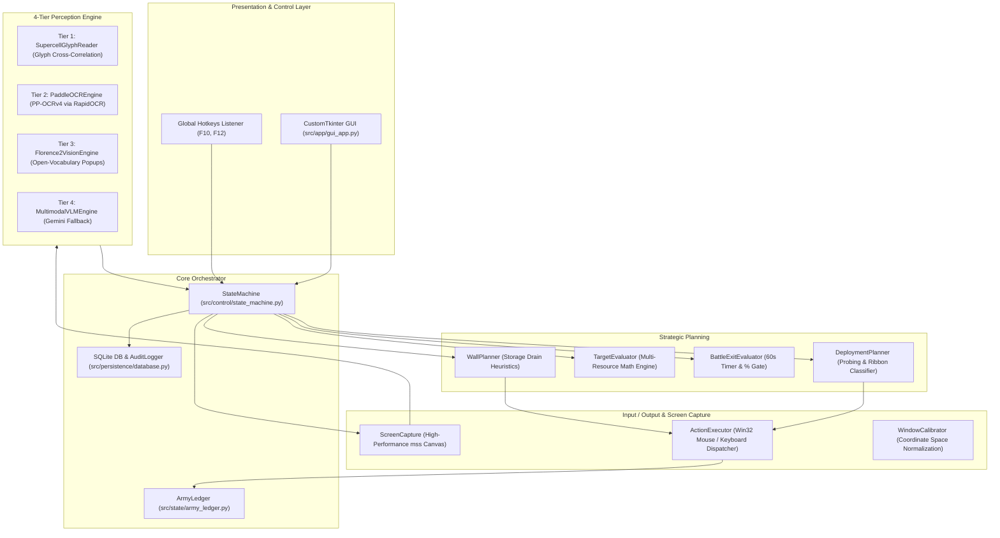

# 🏗️ Technical Architecture & Design Document

This document describes the internal engineering design, computer vision perception pipelines, state machine orchestration, and deployment heuristics of the **Clash of Clans Autonomous Farming Controller**.

---

## 1. High-Level System Architecture

The controller is decoupled into distinct, modular subsystems following the **Layered Agentic Architecture**:

---

## 2. The 4-Tier Perception Pipeline

Perception is designed to eliminate model hallucinations, maximize execution speed, and protect user in-game assets.

| Tier | Engine / Implementation | Purpose & Target Elements | Accuracy & Latency |
|---|---|---|---|
| **Tier 1** | `SupercellGlyphReader` | In-game numerical values (Available Loot, Storages, Combat Timers, % Destruction). | **100% Zero-Hallucination** Latency: < 5ms |
| **Tier 2** | `PaddleOCREngine` (PP-OCRv4) | Arbitrary text, clan names, village labels, unit count badges (`x44`), buttons. | **> 98% Alphanumeric** Latency: ~ 20ms |
| **Tier 3** | `Florence2VisionEngine` | Unknown popups, out-of-sync reload prompts, **strict gem-spending blocking**. | **Zero-Shot Detection** Safety: Air-Tight |
| **Tier 4** | `MultimodalVLMEngine` (Gemini) | Optional cloud escalation for unprecedented dialogs. Fully modular & decoupled. | **Deep Reasoning** Frame Caching: < 1ms |

---

## 3. Universal Dynamic Army Ribbon Classification

In Clash of Clans, the deployment ribbon ordering is invariant across all village configurations:

$$\text{Troops (1..N)} \longrightarrow \text{Siege Machine (0..1)} \longrightarrow \text{Heroes (0..5)} \longrightarrow \text{Spells (1..M)}$$

### Classification Algorithm (`detect_army_slots`):
1. **Contiguous Slot Detection**: Scans normalized coordinates $x \in [0.106, 0.745]$ at ribbon height $y \approx 0.900$ to find all occupied cards.
2. **Badge Reading**: Uses `read_slot_unit_count()` to inspect each slot card's upper badge area for quantity numbers (`xN`).
3. **Partitioning**:
   - **Troop Slots (`layout.troop_slots`)**: Contiguous leading slots starting at Slot 0 that exhibit count badges (e.g. `[0, 1]` for Valkyries and MOMMA P.E.K.K.As).
   - **Spell Slots (`layout.spell_slots`)**: Contiguous trailing slots at the right end of the ribbon that exhibit count badges (e.g. `[5]` for Earthquake).
   - **Middle Slots (Siege & Heroes)**: Slots without count badges situated between troops and spells:
     - `siege_slot`: Assigned to the first middle slot if `deploy_siege` is active.
     - `hero_slots`: Assigned to remaining middle slots (e.g. `[2, 3, 4]`), respecting `configured_hero_count`.

---

## 4. Universal Deployment Protocol (`_execute_full_deployment`)

1. **Directional Probing**: Drops 1 probe troop from Slot 0 beside *"Battle ends in:"* on top grass. Once deployment is confirmed (battle timer begins / next button vanishes), coordinates are locked.
2. **Phase 1: Initial 50% Troop Wave**:
   - Iterates through **all** detected troop slots.
   - Computes $N // 2$ (minus 1 probe troop for Slot 0).
   - Drops exactly 50% of every regular troop type.
3. **Phase 2: Siege Machine**:
   - Selects `layout.siege_slot` and deploys it with 1 single click.
4. **Phase 3: Heroes**:
   - Selects each hero in `layout.hero_slots` sequentially and drops with 1 click each.
5. **Phase 4: Full Troop Depletion**:
   - Iterates through **all** detected troop slots, dumping remaining troops in rapid bursts of 4 taps until the card is greyed out (`is_slot_greyed_out`).
6. **Phase 5: Spells**:
   - Selects each spell in `layout.spell_slots` and casts across base core targets until greyed out.
7. **Phase 6 & 7: Hero Abilities**:
   - Waits 6.0 seconds for units to breach walls, then activates each hero's ability with 1 tap on the ribbon.
8. **Phase 8: Active Ribbon Deselection**:
   - Taps depleted Slot 0 to ensure no hero or spell remains actively selected, preventing unwanted hero clicks during combat monitoring.

---

## 5. Battle Exit Evaluator & Three-Way Gate

During active combat, the bot monitors base destruction and exits upon fulfilling any of three conditions:
1. **Damage Gate**: Base destruction $\ge 60\%$ (or 100% 3-star victory).
2. **Loot Threshold**: Stored loot collected reaches $\ge 65\%$ of initial available loot.
3. **Countdown Timeout**: Combat duration reaches the 60-second farming limit.
4. **Victory Transition**: If the victory screen appears naturally, all exit button clicks are suppressed and the bot transitions immediately to victory loot processing.
